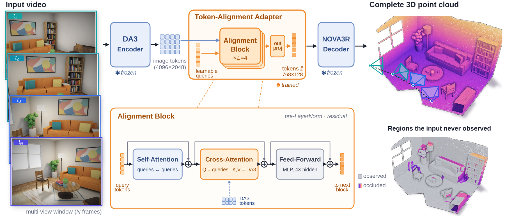
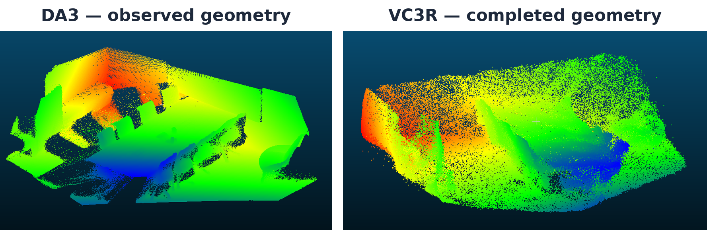
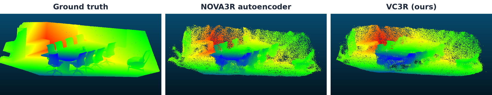

<div align="center">

# VC3R: Video-based Complete 3D Reconstruction

**Complete indoor-scene reconstruction from unposed video by bridging multi-view DA3 features with the generative 3D prior of NOVA3R.**

`DA3 encoder` → `token-alignment adapter` → `NOVA3R decoder` → **complete 3D point cloud**

</div>

<p align="center">
  
</p>

## Overview

VC3R combines two complementary representations for video-based 3D reconstruction:

- **DA3** provides spatially consistent multi-view features and camera estimates from unposed RGB frames.
- A lightweight **token-alignment adapter** maps DA3 image features into the latent scene-token space expected by NOVA3R.
- The frozen **NOVA3R flow-matching decoder** generates a fixed-size, non-pixel-aligned point cloud, allowing the model to reconstruct geometry beyond directly observed surfaces.
- Long videos are reconstructed by predicting local windows and **stitching them into a common scene coordinate frame**.

The core idea is to retain the geometric evidence available in a multi-view foundation model while gaining an amodal 3D prior capable of completing occluded scene structure.

## Highlights

- **Unposed video input.** No ground-truth camera poses are required at inference time.
- **Complete rather than pixel-aligned reconstruction.** The output is not restricted to surfaces directly visible in the input frames.
- **Frozen foundation models.** DA3 and NOVA3R remain frozen; training focuses on the adapter between their latent spaces.
- **Permutation-aware token supervision.** NOVA3R scene tokens are unordered, so training uses Hungarian matching before token-level supervision.
- **Long-sequence reconstruction.** Local predictions can be stitched into full-room reconstructions, with DA3 used as a ground-truth-free consistency signal for filtering unreliable windows.
- **Synthetic + real-world evaluation.** Experiments cover Replica, Neural RGB-D, 7-Scenes, and ScanNet++.

## Completing Occluded Geometry

<p align="center">
  
</p>

DA3 reconstructs geometry supported by the observed views. VC3R instead decodes a global scene representation and can therefore place points in regions that are occluded in the input window.

## Method

Given a window of overlapping RGB frames, VC3R extracts multi-view-aware DA3 tokens and aggregates them using a query-transformer adapter. The adapter contains **768 learnable scene queries** and four alignment blocks with query self-attention, cross-attention to DA3 features, and feed-forward layers. Its output is projected to the **768 × 128** latent representation expected by NOVA3R.

During training, complete target point clouds are encoded with the frozen NOVA3R point-cloud encoder. Because the resulting latent tokens form an unordered set, predicted and target tokens are aligned with the Hungarian algorithm before computing the token loss. A flow-velocity matching term additionally supervises the representation in the space used by the NOVA3R decoder.

At inference time, only the RGB frames are required. DA3 provides the geometric representation and pose estimates, the adapter predicts NOVA3R-compatible scene tokens, and the frozen flow-matching decoder generates the final point cloud.

## Qualitative Results

<p align="center">
  
</p>

On the held-out Replica `office4` scene, the Replica + Neural RGB-D model reaches **5.14 cm Chamfer** and **0.695 F@5**, compared with **2.75 cm / 0.935** for the NOVA3R autoencoder oracle. The remaining gap indicates that latent alignment, rather than decoder capacity alone, is a major bottleneck.

For full-scene reconstruction on `office4`, DA3-guided window filtering improves the stitched reconstruction from **5.19 cm to 4.68 cm Chamfer**, without using ground-truth geometry to choose the rejected windows.

## Repository Layout

```text
vc3r/
├── scripts/
│   ├── setup_eval_env.sh
│   ├── download_da3.py
│   ├── reproduce_office4.sh
│   ├── train_online_var_hungarian.py
│   └── slurm/
├── checkpoints/
│   ├── replica-gtfree.pt
│   ├── replica-nrgbd-gtfree.pt
│   ├── replica-nrgbd-7scenes-scannetpp.pt
│   ├── da3/
│   └── nova3r/
├── datasets/
├── outputs/
└── assets/readme/
```

## Quick Start

### 1. Clone

```bash
git clone --recurse-submodules --branch main <REPOSITORY_URL> vc3r
cd vc3r
```

For an existing clone:

```bash
git submodule update --init --recursive
```

### 2. Create the evaluation environment

Install Miniconda, then run:

```bash
scripts/setup_eval_env.sh --conda /path/to/miniconda3/bin/conda
```

The script creates the environment at:

```text
.conda/envs/vc3r-eval
```

### 3. Download DA3 and prepare checkpoints

```bash
.conda/envs/vc3r-eval/bin/python scripts/download_da3.py
```

Expected artifact layout:

```text
checkpoints/
├── replica-gtfree.pt
├── replica-nrgbd-gtfree.pt
├── replica-nrgbd-7scenes-scannetpp.pt
├── da3/DA3-LARGE-1.1/
│   ├── config.json
│   └── model.safetensors
└── nova3r/scene_ae/
    ├── checkpoint-last.pth
    └── .hydra/config.yaml
```

Obtain the NOVA3R checkpoint using the download instructions from the official NOVA3R repository.

## Data Preparation

For Replica, the evaluator expects:

```text
REPLICA_ROOT/
├── cam_params.json
├── office4_mesh.ply
└── office4/
    ├── traj.txt
    └── results/
        ├── frame000000.jpg
        ├── depth000000.png
        └── ...
```

On the project cluster, the shared Replica dataset can be linked with:

```bash
mkdir -p datasets
ln -s /storage/group/cvpr/chwe/da3_nova3r/replica datasets/replica
```

Other datasets can be evaluated after exposing them in the corresponding folder structure expected by the evaluator.

## Reproduce the Replica `office4` Evaluation

### Local

```bash
scripts/reproduce_office4.sh \
  checkpoints/replica-gtfree.pt \
  datasets/replica \
  --room office4 \
  --complete-target \
  --da3pose-tokens \
  --n-frames 8 \
  --stride 10 \
  --fm-sampling midpoint \
  --fm-step-size 0.04 \
  --num-queries 50000 \
  --seed 42 \
  --da3-model checkpoints/da3/DA3-LARGE-1.1 \
  --offline \
  --out-tag replica_gtfree
```

### SLURM

```bash
sbatch scripts/slurm/eval_office4.sbatch \
  checkpoints/replica-nrgbd-7scenes-scannetpp.pt \
  --room office4 \
  --complete-target \
  --da3pose-tokens \
  --n-frames 8 \
  --stride 10 \
  --fm-sampling midpoint \
  --fm-step-size 0.04 \
  --num-queries 50000 \
  --seed 42 \
  --da3-model checkpoints/da3/DA3-LARGE-1.1 \
  --offline \
  --out-tag four_dataset_gtfree
```

Omit `--max-windows` to evaluate all 25 `office4` windows. Outputs are written to:

```text
outputs/replica/stitch_office4_<out-tag>/
```

Each evaluation contains the stitched point clouds, per-window outputs, and `metrics.json`.

## Available Checkpoints

| Checkpoint | Training data | Objective |
|---|---|---|
| `replica-gtfree.pt` | Replica | Hungarian token MSE + velocity loss |
| `replica-nrgbd-gtfree.pt` | Replica + Neural RGB-D | Hungarian token MSE + velocity loss |
| `replica-nrgbd-7scenes-scannetpp.pt` | Replica + Neural RGB-D + 7-Scenes + ScanNet++ | Hungarian token-matching loss |

The checkpoints are interchangeable in the evaluation pipeline.

## Training

The main training and caching entry points are:

```text
scripts/train_online_var_hungarian.py
scripts/cache_scannetpp.sh
scripts/cache_online_hungarian_zstar_windows.py
```

The caching scripts precompute model tokens so that repeated adapter experiments do not need to rerun the expensive frozen encoders.

## Current Limitations

VC3R currently inherits two important limitations from the latent reconstruction setup:

1. **Fine geometric detail is bounded by the NOVA3R latent representation.** Even the autoencoder oracle loses some high-frequency scene structure.
2. **Window predictions are not perfectly consistent.** Errors can accumulate when independently reconstructed windows are stitched over long sequences.

A natural next step is to preserve high-confidence DA3 geometry explicitly and use the generative branch primarily for unobserved regions, rather than replacing reliable visible geometry.

## Acknowledgements

This project builds on **Depth Anything 3 (DA3)** and **NOVA3R**. Please follow the respective upstream repositories for model licenses, checkpoints, and citation requirements.

---

<p align="center">
  <sub>Video-based Complete 3D Reconstruction of Indoor Scenes · Technical University of Munich</sub>
</p>
